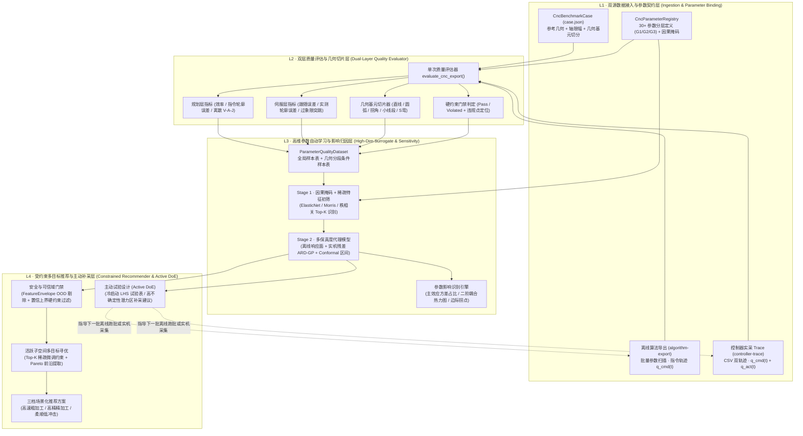
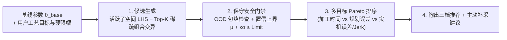

# Axiom CNC 高维参数质量评估、自动学习与智能推荐系统设计规范

> 文档状态：Draft v1.0（面向 30+ 维参数、离线导出与控制器实采双源融合）
> 适用代码基线：`Axiom v0.22+`（衔接 `src/axiom/benchmark.py`、`benchmark_trace.py`、`intelligence/` 与 `optimization/`）
> 关联规范：`CNC-BENCHMARK.md`、`Axiom 通用评估框架规范.md`、`数据集与学习模型规范.md`、`受约束优化与安全闭环规范.md`、`ADR-0028`

## 1. 背景与核心问题诊断

### 1.1 目标愿景

针对 CNC 轨迹规划与运动控制算法，构建一套完整的数据驱动评估与调优闭环：

1. **输入采集数据，自动评估质量**：无论是算法离线批量跑出的规划指令轨迹，还是在真实控制器（如 TwinCAT / CNC 实机）上采集的带编码器反馈的运行 Trace，输入系统后均可对照参考刀路（`case.json`）独立产出分维度、分几何段的质量诊断报告。
2. **输入参数组合，自动建模并识别参数影响**：针对 **30 个以上**的 CNC 算法与控制参数，系统能够从多组“参数组合 + 采集轨迹”中自动学习“参数 $\rightarrow$ 质量指标”的映射关系，定量识别哪些参数是关键主导因子、参数之间如何耦合制约、边际收益拐点在哪里。
3. **给出可解释、受约束的参数推荐系统**：根据用户的加工场景诉求（如粗加工效率优先、精加工轮廓精度优先、表面低振柔顺优先）及硬约束门槛，自动推荐最优参数组合（尤其是只调整少数几个核心参数的“稀疏微调方案”），并在样本不足时主动推荐下一批最值得采集的参数点。

### 1.2 现有 `Axiom` 代码库的断层诊断

审视当前 `Axiom` 仓库实现，现有模块已经打下了扎实的数学、哈希谱系和基础评估底座，但在通往上述闭环的路径上存在**三处结构性断层**：

| 现有模块 | 所在路径 | 已实现能力 | 距目标闭环的核心缺口 |
| :--- | :--- | :--- | :--- |
| **CNC A/B 基准对比主线** | `src/axiom/benchmark.py`<br>`src/axiom/benchmark_trace.py` | 支持读取 `CncBenchmarkCase` 与 CSV/JSON 采样轨迹（`CncAlgorithmExport`），计算运动时长、采样轮廓偏差（Max/RMS/P95/P99）、最低拐角速度、进给利用率和离散 V/A/J | 1. **强制绑定 A/B 成对输入**，缺少独立的单次运行深度质量诊断与几何分段剖析接口；<br>2. `CncAlgorithmExport` **未记录算法/控制器参数字典**，多组运行无法沉淀为参数训练样本；<br>3. `benchmark_trace.py` 仅导入指令位置，未同时消费控制器实采的**实际反馈位置与伺服跟随误差**。 |
| **学习与残差模型（R5）** | `src/axiom/intelligence/training.py` | 实现了不可变数据集快照、防泄漏切分、`FeatureEnvelope` 域外检测、Ridge 回归与 Split Conformal 置信区间 | 特征写死为单条轨迹内部关于时间 $t$ 的 6 维多项式 `[1, t, t², t³, t⁴, cmd - sim]`，学习的是**时序跟踪残差**，而非**30+ 维算法参数组合对轨迹质量指标的响应面模型**。 |
| **参数推荐搜索（R6）** | `src/axiom/optimization/search.py` | 实现了硬约束门禁优先于质量比较、无权重多目标 Pareto 支配排序与推荐解释生成 | 搜索空间写死为内置五轴求解器的 `feedOverride × samplePeriod`（$3 \times 2 = 6$ 点网格），每次候选靠进程内重跑内置 F3/F4 规划器，**无法针对外部 CNC 算法的 30+ 维参数进行代理模型寻优**。 |

### 1.3 三大工程挑战与破局设计原则

在 **30+ 维参数 + 离线/实机双数据源** 的真实工业场景下，方案设计必须正面解决以下三个核心挑战：

1. **挑战一：30+ 维参数的“维度灾难”与小样本矛盾**
   * **问题**：若对 30 个参数直接拟合全二阶多项式响应面，参数项高达 $1 + 30 + \frac{30 \times 31}{2} = 496$ 个；若做 3 水平全因子网格搜索，组合数高达 $3^{30} \approx 2.05 \times 10^{14}$。而工程现场实机采集往往只有几十组，离线跑批通常也只有几百组。
   * **破局原则（物理分组解耦 + 两阶段稀疏活跃子空间学习）**：CNC 的 30+ 个参数绝非扁平无结构的黑盒变量，而是严格遵循**“路径几何平滑（G1）$\rightarrow$ 加减速时间律与滤波（G2）$\rightarrow$ 伺服轴环控制（G3）”**的物理因果链。通过**因果掩码（Causal Mask）**与**稀疏特征筛选（Group LASSO / ARD 相关性确定）**，先为每个质量指标定位出 $5 \sim 8$ 个真正起主导作用的**活跃参数（Active Parameters）**，再在活跃子空间上构建高精度非线性代理模型。
2. **挑战二：离线仿真数据多、控制器实采数据少的异构融合**
   * **问题**：离线算法导出（`algorithm-export`）可以在服务器上几分钟跑完上百组参数，但它只有规划指令（无伺服滞后、摩擦与结构谐振）；控制器实采（`controller-trace`）包含真实的跟随误差与物理响应，但受制于占机时间，采集样本极少。
   * **破局原则（多保真度残差迁移学习 Multi-Fidelity Residual Fusion）**：沿用 `Axiom` 核心规范“先数学规划、再物理残差”的思想——用高通量的**离线数据**充分学习 15+ 个规划参数对指令质量的响应面 $\hat{\boldsymbol{y}}_{\text{plan}}(\boldsymbol{\theta}_{\text{plan}})$；再用小样本**控制器实采数据**专门学习“从规划指令特征 + 伺服参数到实机误差”的物理残差模型 $\hat{\boldsymbol{\delta}}_{\text{servo}}(\boldsymbol{\theta}_{\text{plan}}, \boldsymbol{\theta}_{\text{servo}}, \boldsymbol{z}_{\text{cmd}})$。
3. **挑战三：现场调参的可解释性与“稀疏微调”需求**
   * **问题**：如果推荐系统一次性要求工程师同时修改全部 30 个参数，现场既无法理解每个参数改动的原因，也无法在出现异常时快速定位和回滚。
   * **破局原则（敏感度归因透明化 + Top-$K$ 稀疏微调推荐）**：模型必须先输出直观的**参数敏感度归因矩阵与边际拐点曲线**，回答“哪个参数影响了哪个指标”；在推荐阶段引入 $\ell_0$ 稀疏变动约束（$\|\boldsymbol{\theta} - \boldsymbol{\theta}_{\text{baseline}}\|_0 \le K_{\max}$，默认 $K_{\max} \in [3, 6]$），优先给出**“保持其余 25+ 个参数不动，仅调整最关键的 3～5 个参数即可达成目标”**的推荐方案。

## 2. 总体系统架构与闭环数据流

本方案在 `Axiom` 现有 `benchmark` 主线之上构建四层递进架构，完全复用 `AxiomModel` 的确定性 SHA-256 内容寻址、硬约束门禁与证据追溯机制：



## 3. 30+ 维 CNC 参数体系的分层建模与数据契约

### 3.1 参数三层物理分类体系（Parameter Hierarchy）

为了避免将 30+ 个参数当作无结构的扁平黑盒向量，系统引入 `ParameterGroup` 物理分层契约。所有待评估和调优的参数按其在 CNC 控制链中的物理位置划分为三层：

1. **`G1 · 路径几何平滑与前瞻层（Geometry & Lookahead Group）`**：作用于刀具路径几何预处理、小线段压缩拟合、拐角过渡圆滑（Corner Rounding）与多段前瞻（Lookahead）窗口。直接决定指令轨迹与原始编程路径之间的**几何逼近偏差**以及**拐角允许通过速度**。
2. **`G2 · 运动学时间律与插补滤波层（Kinematics & Trajectory Filtering Group）`**：作用于 S 型加减速规划（Velocity/Acceleration/Jerk 限幅）、向心加速度限幅及插补后 FIR/IIR 平滑滤波器时间常数。直接决定**加工周期时长**与**指令加速度/加加速度（Jerk）的平滑度**。
3. **`G3 · 伺服控制环与动态补偿层（Servo Loop & Dynamic Compensation Group）`**：作用于各轴位置环/速度环增益、速度/加速度前馈系数、摩擦/反向间隙补偿及陷波滤波器。仅在**控制器实采（`controller-trace`）或闭环物理仿真**中生效，决定**实际编码器位置对指令位置的跟随残差**。

以下为标准化的 32 个典型 CNC 算法与控制器参数参考注册表（用户可通过 JSON 配置文件自由增删或映射自定义参数名）：

| 参数分组 | 参数 ID (`parameterId`) | 物理含义 | 单位 | 典型可调范围 | 作用的观测源 | 主要影响的质量维度 |
| :--- | :--- | :--- | :--- | :--- | :--- | :--- |
| **G1 几何与前瞻** | `g1.corner_tolerance_mm` | 拐角平滑最大允许弦高/轮廓允差 | `mm` | `[0.001, 0.100]` | 离线 + 实机 | 拐角速度、最大轮廓偏差、加工时长 |
| **G1 几何与前瞻** | `g1.small_seg_chord_tol_mm` | 密集小线段压缩/样条拟合弦高允差 | `mm` | `[0.0005, 0.050]` | 离线 + 实机 | 小线段簇进给利用率、指令轮廓偏差 |
| **G1 几何与前瞻** | `g1.lookahead_block_count` | 前瞻缓冲区最大程序段数 | `blocks` | `[20, 500]` | 离线 + 实机 | 密集小线段加工时长、计算耗时 |
| **G1 几何与前瞻** | `g1.corner_angle_threshold_deg` | 触发拐角精确停或插入过渡段的角度阈值 | `deg` | `[3.0, 45.0]` | 离线 + 实机 | 拐角最低速度、拐角冲击峰值 |
| **G1 几何与前瞻** | `g1.collinear_merge_angle_deg` | 相邻微线段共线合并阈值角 | `deg` | `[0.05, 2.0]` | 离线 + 实机 | 小线段平顺性、速度波动率 |
| **G1 几何与前瞻** | `g1.curvature_speed_clamp_factor` | 圆弧/自由曲线曲率限速安全系数 | `ratio` | `[0.50, 1.20]` | 离线 + 实机 | 圆弧段进给速度、圆弧径向偏差 |
| **G1 几何与前瞻** | `g1.min_segment_length_mm` | 极短微线段滤除/合并最小长度 | `mm` | `[0.001, 0.050]` | 离线 + 实机 | 离散 Jerk 噪声、插补周期稳定性 |
| **G1 几何与前瞻** | `g1.spline_degree` | 小线段平滑样条阶数（3=三次，5=五次） | `int` | `{3, 5}` | 离线 + 实机 | 曲率连续性、指令 Jerk RMS |
| **G2 规划与滤波** | `g2.path_max_feed_override` | 路径切向编程进给倍率上限 | `ratio` | `[0.50, 1.20]` | 离线 + 实机 | 加工时长、进给利用率 |
| **G2 规划与滤波** | `g2.path_tangential_acc_mm_s2` | 路径切向合成最大加速度 | `mm/s^2` | `[1000, 15000]` | 离线 + 实机 | 启停段时长、加减速冲击 |
| **G2 规划与滤波** | `g2.path_tangential_jerk_mm_s3` | 路径切向合成最大 Jerk（S 曲线斜率） | `mm/s^3` | `[20000, 1000000]` | 离线 + 实机 | 加工时长、全路径 `discreteJerkRms` |
| **G2 规划与滤波** | `g2.centripetal_acc_limit_mm_s2` | 圆弧/拐角法向（向心）最大允许加速度 | `mm/s^2` | `[500, 8000]` | 离线 + 实机 | 圆弧与拐角限速、拐角动态轮廓误差 |
| **G2 规划与滤波** | `g2.axis_vel_limit_x/y/z` (3 项) | X/Y/Z 各轴最大允许规划速度 | `mm/s` | `[100, 1000]` | 离线 + 实机 | 轴速度限幅裕度、高速段耗时 |
| **G2 规划与滤波** | `g2.axis_acc_limit_x/y/z` (3 项) | X/Y/Z 各轴最大允许规划加速度 | `mm/s^2` | `[1000, 12000]` | 离线 + 实机 | 轴加速度峰值、加减速时间 |
| **G2 规划与滤波** | `g2.axis_jerk_limit_x/y/z` (3 项) | X/Y/Z 各轴最大允许规划 Jerk | `mm/s^3` | `[20000, 800000]` | 离线 + 实机 | 单轴 Jerk 峰值、拐角加减速平顺度 |
| **G2 规划与滤波** | `g2.fir_moving_avg_time_ms` | 插补后一阶滑动平均（FIR）滤波时间常数 | `ms` | `[0.0, 64.0]` | 离线 + 实机 | 极显著降低 Jerk，但会增大圆弧/拐角指令内缩误差 |
| **G2 规划与滤波** | `g2.biquad_lowpass_freq_hz` | 插补指令二阶低通滤波截止频率 | `Hz` | `[10.0, 200.0]` | 离线 + 实机 | 高频 Jerk 抑制、相位滞后引起的轮廓偏差 |
| **G2 规划与滤波** | `g2.bell_acc_shape_factor` | 钟形加减速平滑系数（梯形到正弦过渡） | `ratio` | `[0.0, 1.0]` | 离线 + 实机 | 加速度跳变抑制、运动总时长 |
| **G3 伺服与补偿** | `g3.servo_kp_x/y/z` (3 项) | X/Y/Z 各轴位置环比例增益 $K_v$ | `1/s` | `[20.0, 150.0]` | **仅实机 Trace** | 稳态跟随误差、多轴增益不匹配引起的轮廓误差 |
| **G3 伺服与补偿** | `g3.vel_feedforward_x/y/z` (3 项) | X/Y/Z 各轴速度前馈系数 | `ratio` | `[0.80, 1.02]` | **仅实机 Trace** | 匀速与加减速段跟随滞后 |
| **G3 伺服与补偿** | `g3.acc_feedforward_x/y/z` (3 项) | X/Y/Z 各轴加速度/扭矩前馈系数 | `ratio` | `[0.0, 1.00]` | **仅实机 Trace** | 拐角与高加速段动态跟随误差峰值 |
| **G3 伺服与补偿** | `g3.friction_comp_amp_x/y/z` (3 项) | X/Y/Z 轴过象限摩擦/反向突跳补偿幅值 | `mm` / `%` | `[0.0, 0.020]` | **仅实机 Trace** | 整圆过象限突起（Quadrant Glitch）峰值 |
| **G3 伺服与补偿** | `g3.notch_filter_freq_hz` | 机械谐振陷波器中心频率 | `Hz` | `[40.0, 400.0]` | **仅实机 Trace** | 实测速度/电流纹波、表面振纹指标 |

### 3.2 因果解耦掩码（Causal Dependency Mask）

在 30+ 维参数建模中，系统强制引入**先验因果掩码矩阵 $\mathbf{M} \in \{0, 1\}^{D \times M}$**（行表示 $D$ 个参数，列表示 $M$ 个质量指标）：

1. **离线规划指标隔离**：对于任何规划层指标（如 `durationSeconds`、`sampledPathDeviationMaxMm`、`discreteJerkRms`），所有 `G3` 伺服参数的掩码权重恒为 `0`。无论采集数据中 `G3` 参数如何变化，学习器都不会将规划轨迹的差异错误归因到伺服增益上。
2. **轴向解耦隔离**：对于单轴特定指标（如 `X.followingErrorMaxMm` 或 `X.discreteJerkMax`），其他轴的专属伺服参数（如 `g3.servo_kp_y`、`g3.servo_kp_z`）默认设置强先验正则惩罚，仅在跨轴合成轮廓误差（`actualContourErrorMaxMm`）中放开多轴增益匹配交互项（如 $|K_{p,x} - K_{p,y}|$）。
3. **几何基元条件隔离**：在纯直线段（`line`）切片上，拐角类参数（`g1.corner_tolerance_mm`）与向心加速度参数（`g2.centripetal_acc_limit_mm_s2`）掩码为 `0`；只有在拐角（`corner`）与圆弧（`arc`）切片上才激活。

通过这三条物理先验，原本 32 维的全局耦合空间被天然拆解为若干个 **6～12 维的良态子问题**，使 20～50 组样本即可完成稳健建模。

### 3.3 扩展后的数据契约（JSON Schema）

#### 3.3.1 参数空间注册表 `axiom.cnc-parameter-registry@1`

```json
{
  "schemaId": "axiom.cnc-parameter-registry@1",
  "registryId": "cnc.planner-and-servo.32d@1",
  "parameters": [
    {
      "parameterId": "g1.corner_tolerance_mm",
      "displayName": "拐角平滑允差",
      "group": "G1_GeometryLookahead",
      "unit": "mm",
      "valueType": "continuous",
      "bounds": [0.001, 0.100],
      "defaultValue": 0.020,
      "appliesToSources": ["algorithm-export", "controller-trace"],
      "axisScope": "path",
      "expectedMonotonicity": {
        "durationSeconds": "non-increasing",
        "sampledPathDeviationMaxMm": "non-decreasing"
      }
    },
    {
      "parameterId": "g2.fir_moving_avg_time_ms",
      "displayName": "FIR 插补平滑时间常数",
      "group": "G2_KinematicsFilter",
      "unit": "ms",
      "valueType": "continuous",
      "bounds": [0.0, 64.0],
      "defaultValue": 16.0,
      "appliesToSources": ["algorithm-export", "controller-trace"],
      "axisScope": "path"
    },
    {
      "parameterId": "g3.servo_kp_x",
      "displayName": "X轴位置环增益",
      "group": "G3_ServoControl",
      "unit": "1/s",
      "valueType": "continuous",
      "bounds": [20.0, 120.0],
      "defaultValue": 60.0,
      "appliesToSources": ["controller-trace"],
      "axisScope": "X"
    }
  ],
  "derivedFeatures": [
    {
      "featureId": "derived.kp_xy_mismatch",
      "expression": "abs(g3.servo_kp_x - g3.servo_kp_y)",
      "description": "XY双轴位置环增益失配度，直接驱动圆弧与斜线动态轮廓误差"
    }
  ]
}
```

#### 3.3.2 兼容扩展的轨迹导出格式（扩展 `CncAlgorithmExport`）

在 `src/axiom/benchmark.py` 的 `CncAlgorithmExport` 与 `BenchmarkSample` 中增加向后兼容的可选字段：

* `parameters`: 记录本次运行的 30+ 维参数键值对，以及绑定的 `parameterRegistryHash`；
* `actualPositionMm`: 在 `BenchmarkSample` 中作为可选字段。离线算法导出（`algorithm-export`）仅填 `positionMm`（指令位置）；控制器采集（`controller-trace`）可同时填入 `positionMm`（控制器插补指令）与 `actualPositionMm`（光栅尺/编码器实测反馈位置）。

```json
{
  "schemaId": "axiom.cnc-algorithm-export@1",
  "algorithmId": "cnc.five-axis-planner",
  "algorithmVersion": "v2.4.1-release",
  "sourceKind": "controller-trace",
  "caseContentHash": "a94f8d2c7e0b1a...",
  "coordinateFrame": "workpiece",
  "unit": "mm",
  "samplePeriodSeconds": 0.001,
  "parameterRegistryId": "cnc.planner-and-servo.32d@1",
  "parameters": {
    "g1.corner_tolerance_mm": 0.015,
    "g1.small_seg_chord_tol_mm": 0.005,
    "g1.lookahead_block_count": 150,
    "g2.path_tangential_acc_mm_s2": 6000.0,
    "g2.path_tangential_jerk_mm_s3": 120000.0,
    "g2.fir_moving_avg_time_ms": 12.0,
    "g3.servo_kp_x": 65.0,
    "g3.servo_kp_y": 65.0,
    "g3.vel_feedforward_x": 0.98
  },
  "samples": [
    {
      "sampleIndex": 0,
      "t": 0.0,
      "positionMm": [0.0, 0.0, 0.0],
      "actualPositionMm": [0.0, 0.0, 0.0]
    },
    {
      "sampleIndex": 1,
      "t": 0.001,
      "positionMm": [0.012, 0.0, 0.0],
      "actualPositionMm": [0.0108, 0.0, 0.0]
    }
  ]
}
```

## 4. 第一阶段：双源采集数据的单次质量评估器（Quality Evaluator）

### 4.1 从成对 A/B 对比扩展到单次深度评估

在 `src/axiom/benchmark.py` 中，将原有的内部函数 `_analyse(case, run)` 升级并公开为 `evaluate_cnc_export(case, run) -> CncQualityReport`。用户无需先准备 baseline 和 candidate 两份文件，只要导入任意一份离线导出或控制器 CSV，即可立即生成完整的单次质量报告。

### 4.2 双层四维质量评价体系（规划层 + 伺服物理层）

系统严格遵守 `Axiom` 宪法：**不将不同量纲的指标加权合成单一“玄学总分”**，而是按“硬约束门禁 + 四个正交质量维度”输出结构化向量：

| 层级与维度 | 指标 ID (`metricId`) | 计算方法与物理定义 | 适用数据源 | 优化方向 / 门禁性质 |
| :--- | :--- | :--- | :--- | :--- |
| **0. 硬约束门禁**<br>(Hard Gates) | `gate.position_range`<br>`gate.path_deviation_max`<br>`gate.endpoint_error`<br>`gate.discrete_v_a_j` | 各轴采样位置是否越界、最大轮廓误差是否超过 `maximumPathDeviationMm`、首尾是否到位、各轴离散 V/A/J 是否超过 `axisLimits` | 离线 + 实机 | **一票否决（Pass / Violated）**，记录首个与最差超限采样点索引、时间戳与参考段号 |
| **1. 加工效率维度**<br>(Efficiency) | `durationSeconds`<br>`feedUtilization`<br>`cornerSpeedMinMmS`<br>`highSpeedCoverageRatio` | 轨迹总运动耗时 $T_{\text{total}}$；<br>参考路径总长 $\div (T_{\text{total}} \times F_{\text{prog}})$；<br>转角 $\ge 5^\circ$ 顶点处的最低中心差分速度；<br>实际速度达到编程进给 $90\%$ 以上的时间占比 | 离线 + 实机 | `durationSeconds` 越小越好；<br>`feedUtilization` 与 `cornerSpeedMinMmS` 越大越好 |
| **2. 规划几何精度维度**<br>(Command Accuracy) | `sampledPathDeviationMaxMm`<br>`sampledPathDeviationRmsMm`<br>`sampledPathDeviationP99Mm`<br>`arcRadialShrinkMaxMm` | 指令位置序列 $\boldsymbol{q}_{\text{cmd}}(t)$ 到参考折线/圆弧的逐点最短距离的最大值、均方根、99 分位数，以及圆弧段因滤波导致的径向内缩量 | 离线 + 实机 | 越小越好（反映插补/平滑算法本身的几何逼近保真度） |
| **3. 运动柔顺与冲击维度**<br>(Smoothness & Jerk) | `discreteJerkRms`<br>`discreteJerkMax`<br>`discreteAccelerationRms`<br>`velocityRippleRatio` | 指令位置三阶差分 $\Delta^3 \boldsymbol{q}_{\text{cmd}} / T^3$ 的全路径均方根与峰值；<br>密集小线段区域的切向速度波动率 $\sigma_v / \mu_v$ | 离线 + 实机 | 越小越好（直接决定机床激励频谱与加减速冲击感） |
| **4. 伺服跟踪与实测精度**<br>(Servo & Actual Quality) | `followingErrorMaxMm`<br>`followingErrorRmsMm`<br>`actualPathDeviationMaxMm`<br>`actualPathDeviationRmsMm`<br>`quadrantGlitchMaxMm` | 轴向跟随误差 $\|\boldsymbol{q}_{\text{act}}(t) - \boldsymbol{q}_{\text{cmd}}(t)\|$ 的峰值与 RMS；<br>实测位置 $\boldsymbol{q}_{\text{act}}(t)$ 相对参考路径 `referencePath` 的真实轮廓误差峰值与 RMS；<br>圆弧过象限（速度过零反向）窗口内的径向突跳峰值 | **仅实机 Trace**<br>（含 `actualPositionMm`） | 越小越好（反映伺服环参数与规划指令动态特性的匹配质量） |

### 4.3 几何基元自动切片器（Geometric Primitive Slicing）

如果每次试验只提取整条轨迹的 1 组全局指标，跑 20 次只有 20 行数据；但一条综合测试刀路（或实际零件刀路）内部往往包含数十个直线段、不同角度的拐角、不同半径的圆弧以及密集小线段簇。

评估器在执行全局评估的同时，自动根据 `CncBenchmarkCase.referencePath` 和 `referenceArcs` 将采样点投影归属到各个几何局部窗口，生成 `SegmentQualitySlice` 列表：

1. **直线加速/巡航切片（`LineSegmentSlice`）**：提取段长 $L$、方向单位向量 $(u_x, u_y, u_z)$，评估该段的巡航速度达成率与跟随滞后。
2. **拐角过渡切片（`CornerTransitionSlice`）**：以每个转角 $\Delta\alpha \ge 5^\circ$ 的顶点为中心，截取前后各 $d_{\text{win}}$（如 $2\text{ mm}$）窗口内的采样点，提取几何特征 $\boldsymbol{g}_{\text{corner}} = [\Delta\alpha, L_{\text{in}}, L_{\text{out}}, \text{轴向变化向量}]$，单独计算**该拐角处的最大内缩偏差 $e_{\text{corner}}$、最低过弯速度 $v_{\text{corner}}$ 与峰值 Jerk**。
3. **圆弧切片（`ArcSegmentSlice`）**：针对 `referenceArcs` 标记的圆弧段，提取圆弧半径 $R$、扫掠角 $\Delta\theta$、法向向心加速度理论值 $v^2/R$，单独计算**圆弧稳态径向内缩误差 $\Delta R_{\text{shrink}}$ 与过象限突跳峰值**。
4. **密集小线段簇切片（`MicroSegmentClusterSlice`）**：自动识别连续段长 $< 0.5\text{ mm}$ 的微线段区间，提取平均弦长 $\bar{l}$、局部曲率变化率，单独评估**小线段区间平均进给率与速度波动率**。

通过几何基元切片，**1 次综合刀路采集即可自动拆解出 15～50 条“（参数组合 $\boldsymbol{\theta}$ + 局部几何特征 $\boldsymbol{g}$）$\rightarrow$ 局部质量指标”的精细训练样本**，极大缓解高维参数下的样本饥渴问题。

## 5. 第二阶段：30+ 高维参数自动建模与影响识别（High-Dimensional Learning & Attribution）

### 5.1 为什么分两阶段建模？

当参数维度 $D \ge 30$ 时，如果把全部参数直接丢入高阶多项式或标准高斯过程（GP）：
* 样本数 $N < 50$ 时会出现严重的病态矩阵过拟合，把随机噪声当成某个无关参数的显著效应；
* 各向同性核函数在 30 维欧氏空间中的距离高度集中（距离对比度失效），导致 GP 预测退化为常数均值。

因此，本系统设计了**“Stage 1 因果掩码与稀疏主效应筛选 $\rightarrow$ Stage 2 活跃子空间多保真度代理建模”**的两阶段确定性学习流水线。

### 5.2 Stage 1：因果掩码与稀疏活跃参数筛选（Active Subspace Screening）

对每一个目标质量指标 $m$（如 `durationSeconds`、`sampledPathDeviationMaxMm`、`actualPathDeviationMaxMm`），学习器按以下三步自动识别出起主导作用的 **Top-$K$ 活跃参数集合 $\mathcal{A}_m \subset \{1, \dots, D\}$**（通常 $K \le 8$）：

1. **物理因果掩码过滤（Hard Causal Masking）**：
   读取 `CncParameterRegistry` 的分组规则：
   * 若指标 $m$ 属于规划层指标（如 `sampledPathDeviationMaxMm`、`discreteJerkRms`），直接将所有 `G3_ServoControl` 参数列置零排除，候选参数维度从 32 维立即降至 18 维；
   * 若指标属于特定几何切片（如拐角最大误差 `corner.deviationMaxMm`），仅保留与拐角平滑、切向/法向加减速和滤波器相关的候选参数。
2. **标准化一阶加二次主效应稀疏回归（ElasticNet / Group LASSO Screening）**：
   将剩余 $d$ 个候选参数按观测范围归一化至 $\tilde{\theta}_j \in [-1, +1]$，构造只含**一阶线性项 $\tilde{\theta}_j$、纯二次曲率项 $\tilde{\theta}_j^2$ 以及物理声明的先验派生项（如 $|K_{p,x} - K_{p,y}|$）**的设计矩阵 $\mathbf{\Phi}_{\text{main}} \in \mathbb{R}^{N \times (2d + p)}$（此时不含 $O(d^2)$ 任意交叉项，维度仅为 $30 \sim 40$），求解带弹性网惩罚的凸优化问题：
   $$\hat{\boldsymbol{w}} = \arg\min_{\boldsymbol{w}} \frac{1}{2N} \|\boldsymbol{y}_m - \mathbf{\Phi}_{\text{main}} \boldsymbol{w}\|_2^2 + \lambda \left( \alpha \|\boldsymbol{w}\|_1 + \frac{1-\alpha}{2} \|\boldsymbol{w}\|_2^2 \right)$$
   其中 $\lambda$ 通过组隔离（Group-Disjoint）交叉验证自动选定。参数 $j$ 的一阶+二阶综合归因权重定义为 $S_j^{\text{linear}} = |w_{j,1}| + |w_{j,2}|$。
3. **非线性单调秩相关补充校验（Spearman / Morris Elementary Effect）**：
   为防止阶跃型或强非线性参数被线性/二次基漏筛，同时计算每个参数 $\tilde{\theta}_j$ 与残差的 Spearman 秩相关系数 $|\rho_j|$（或在网格/轨迹采样下计算基本效应均值 $\mu_j^*$）。最终参数 $j$ 对指标 $m$ 的活跃度得分为归一化融合分，按累计解释贡献达到 $90\%$（或最多保留前 $K=8$ 个参数）截断，得到该指标的**活跃参数子集 $\mathcal{A}_m$**，其余参数标记为 `Insensitive / Inert`。

### 5.3 Stage 2：活跃子空间上的多保真度代理模型（Multi-Fidelity Surrogate）

在筛选出的活跃参数子集 $\mathcal{A}_m$（维度 $k = |\mathcal{A}_m| \le 8$）上，维度灾难已被消除，此时可安全引入参数间二阶交互项 $\tilde{\theta}_i \tilde{\theta}_j$（仅 $\binom{k}{2} \le 28$ 项）与非线性核函数：

#### 5.3.1 离线规划代理模型 $\hat{f}_{\text{plan}}(\boldsymbol{\theta}_{\mathcal{A}_m}, \boldsymbol{g})$

采用**“稀疏二阶多项式趋势项 + 各向异性 Matérn-5/2 高斯过程（ARD-GP）”**的复合代理结构（完全可用纯 `NumPy` 线性代数实现，无需外部 C++ 编译依赖）：

$$\hat{y}_m(\boldsymbol{x}) = \underbrace{\boldsymbol{\phi}_2(\boldsymbol{x})^\top \boldsymbol{\beta}}_{\text{全局二阶响应面趋势}} + \underbrace{\boldsymbol{k}(\boldsymbol{x}, \mathbf{X})^\top (\mathbf{K} + \sigma_n^2 \mathbf{I})^{-1} (\boldsymbol{y}_m - \mathbf{\Phi}_2 \boldsymbol{\beta})}_{\text{局部非线性 GP 修正}}, \quad \boldsymbol{x} = [\tilde{\boldsymbol{\theta}}_{\mathcal{A}_m}, \tilde{\boldsymbol{g}}]$$

* **预测均值 $\hat{\mu}_m(\boldsymbol{x})$**：平滑結合了全局二次趋势（如允差增大导致误差上升、时间下降的宏观趋势）与局部非线性拐点；
* **预测不确定性 $\hat{\sigma}_m(\boldsymbol{x})$**：由 GP 后验方差 $k(\boldsymbol{x}, \boldsymbol{x}) - \boldsymbol{k}^\top (\mathbf{K} + \sigma_n^2 \mathbf{I})^{-1} \boldsymbol{k}$ 结合 `Axiom` 现有的 **Split Conformal 校准分位数 $q_{1-\alpha}$** 共同给出，保证在可交换测试集上的真实误差覆盖率 $\ge 1 - \alpha$（默认 $85\% \sim 90\%$）。

#### 5.3.2 离线 + 控制器实采的双源多保真融合（Co-Kriging / 残差学习）

针对既有大量离线导出（设为数据集 $\mathcal{D}_{\text{off}}$，$N_{\text{off}} \sim 100+$），又有少量控制器实采 Trace（设为数据集 $\mathcal{D}_{\text{ctrl}}$，$N_{\text{ctrl}} \sim 15-30$）的场景，系统采用**分层残差迁移架构**：

1. **先用 $\mathcal{D}_{\text{off}}$ 训练规划指标基线模型**：得到准确的规划耗时预测 $\hat{T}_{\text{plan}}(\boldsymbol{\theta}_{G1,G2})$、规划轮廓偏差 $\hat{E}_{\text{plan}}(\boldsymbol{\theta}_{G1,G2})$ 以及规划指令的运动学激励特征预测 $\hat{\boldsymbol{z}}_{\text{kin}}(\boldsymbol{\theta}_{G1,G2}) = [\hat{V}_{\max}, \hat{A}_{\max}, \hat{J}_{\text{rms}}, \hat{V}_{\text{corner}}]$。
2. **再用 $\mathcal{D}_{\text{ctrl}}$ 训练实机物理残差模型**：
   对于实机真实轮廓误差 $E_{\text{actual}}$，将其分解为：
   $$E_{\text{actual}}(\boldsymbol{\theta}_{G1,G2,G3}) = \hat{E}_{\text{plan}}(\boldsymbol{\theta}_{G1,G2}) + \hat{\delta}_{\text{servo}}\big(\hat{\boldsymbol{z}}_{\text{kin}}(\boldsymbol{\theta}_{G1,G2}),\, \boldsymbol{\theta}_{G3,\text{active}}\big)$$
   **核心优势**：控制器实采模型不需要从零开始重新学习 18 个 `G1/G2` 规划参数是如何变成速度和加速度的！它只需要以**规划出来的运动学激烈程度 $\hat{\boldsymbol{z}}_{\text{kin}}$（仅 3～4 维）+ 活跃的 `G3` 伺服参数（如 $K_p$、前馈、摩擦补偿，仅 4～6 维）**作为输入，去拟合实机相比规划多出来的那部分伺服残差 $\delta_{\text{servo}}$。这使得哪怕只有 **15～20 组实机控制器采集数据**，也能精准预测出 30+ 维参数组合在实机上的最终效果。

### 5.4 自动输出“参数影响识别报告”（Parameter Impact & Attribution Report）

每次模型训练完成后，系统自动针对全部 30+ 个参数生成三类可解释工程洞察：

1. **参数-指标敏感度归因表（Global Sensitivity Matrix）**：
   通过方差分解（一阶主效应贡献率 $S_{j,m} \in [0, 1]$）与符号方向（$\text{sign}(\partial \hat{y}_m / \partial \theta_j)$），自动输出哪些参数是主导因子：
   * 示例输出：
     * 对 `durationSeconds`（加工时间）：`g2.path_tangential_acc_mm_s2`（主效应占比 **38.2%**，负相关 $\downarrow$）、`g1.corner_tolerance_mm`（占比 **29.5%**，负相关 $\downarrow$）、`g2.path_tangential_jerk_mm_s3`（占比 **18.4%**，负相关 $\downarrow$），其余 29 个参数合计占比 `< 14%`。
     * 对 `sampledPathDeviationMaxMm`（指令最大轮廓误差）：`g1.corner_tolerance_mm`（占比 **54.1%**，正相关 $\uparrow$）、`g2.fir_moving_avg_time_ms`（占比 **31.8%**，正相关 $\uparrow$）。
     * 对 `actualPathDeviationMaxMm - sampledPathDeviationMaxMm`（实机伺服附加轮廓误差）：`derived.kp_xy_mismatch`（占比 **46.0%**，正相关 $\uparrow$）、`g3.acc_feedforward_x/y`（占比 **33.5%**，负相关 $\downarrow$）。
2. **二阶参数耦合效应识别（Pairwise Interaction Discovery）**：
   提取标准化二阶交叉项系数 $|w_{ij}|$ 最大的前 5 对参数，自动生成工程提示：
   * 例如识别出 `g1.corner_tolerance_mm × g2.centripetal_acc_limit_mm_s2` 强耦合：“当向心加速度限幅过低时，单纯放大拐角允差无法提升拐角速度，反而徒增内缩误差”。
   * 例如识别出 `g2.path_tangential_jerk_mm_s3 × g3.acc_feedforward_x` 强耦合：“在未开启加速度前馈（`< 0.5`）时，盲目调高规划 Jerk 会导致实机跟随误差峰值激增 2.4 倍”。
3. **单参数边际收益与拐点定位（Marginal Response & Knee-Point Finder）**：
   对每个活跃参数 $\theta_j$，在保持其余参数为基线值 $\boldsymbol{\theta}_{\text{base}}$ 下进行一维连续扫描，计算加工时间下降率与轮廓误差上升率的比值（边际弹性），自动标出**最佳性价比拐点（Knee Point）**（例如：`g2.fir_moving_avg_time_ms` 在 `0 -> 12 ms` 时 Jerk RMS 下降 $62\%$ 而轮廓误差仅增 $0.004\text{ mm}$；超过 `16 ms` 后 Jerk 改善趋平但圆弧内缩误差线性恶化，故识别 `12~16 ms` 为甜点区间）。

## 6. 第三阶段：受约束多目标参数推荐与主动补采系统（Recommendation & Active DoE）

### 6.1 推荐系统的核心设计：活跃子空间寻优 + Top-$K$ 稀疏微调

面对 30+ 个参数，直接输出一组改动了全部 32 个数字的参数表在工程现场是不可用的。本推荐系统采用**“基线锚定 + 稀疏微调（Sparse Delta Recommendation）”**机制：

* 用户提供一个当前正在使用的**基线参数组合 $\boldsymbol{\theta}_{\text{base}}$**（或系统默认基线）以及**允许同时修改的最大参数个数 $K_{\max}$**（默认 $K_{\max} = 5$，也可设为不限制）。
* 优化器仅在 Stage 1 识别出的**并集活跃参数子空间 $\mathcal{A} = \bigcup_m \mathcal{A}_m$**（通常 $8 \sim 12$ 个参数）内选择至多 $K_{\max}$ 个最有效的参数进行调整，其余 $32 - K_{\max}$ 个不敏感或次要参数**严格保持 $\boldsymbol{\theta}_{\text{base}}$ 原值不变**。

### 6.2 四级推荐决策流水线



#### 步骤 1：活跃子空间与稀疏组合候选生成

1. 若用户锁定了某些不可改参数（如机床硬件极限锁死的 `axis_vel_limit`），先将其固定；
2. 在活跃参数集合 $\mathcal{A}$ 中，枚举或贪心选择最具杠杆效应的 $K_{\max}$ 参数子集，使用拉丁超立方采样（LHS）与围绕基线 $\boldsymbol{\theta}_{\text{base}}$ 的局部信任域网格生成 $5,000 \sim 20,000$ 个候选参数向量（代理模型矩阵化推理 10,000 个点耗时仅 `< 50 ms`）。

#### 步骤 2：可信域（OOD）与保守硬约束门禁（Safety & Epistemic Gate）

延续 `Axiom` 核心规范 `受约束优化与安全闭环规范.md` 的硬门禁要求，任何候选 $\boldsymbol{\theta}$ 必须先通过两道硬门：

1. **适用域包络门禁（OOD Gate）**：检查活跃参数是否落在已采集样本的扩展凸包/超矩形包络（`FeatureEnvelope`）及马氏距离阈值内。若超出训练域过远，标记为 `OutOfDomain`，禁止直接作为生产参数推荐（转入主动补采候选池）。
2. **保守不确定性硬约束门禁（Conservative Constraint Gate）**：
   对于用户设定的每项硬上限（如最大允许轮廓误差 $E_{\text{limit}}$、最大允许跟随误差 $F_{\text{limit}}$、最大允许 Jerk $J_{\text{limit}}$），不仅要求预测均值达标，还要求在安全系数 $\kappa$（默认 $\kappa = 1.0$ 对应 Conformal 区间上界）下的**保守悲观上界**不超限：
   $$\hat{\mu}_{\text{dev}}(\boldsymbol{\theta}) + \kappa \cdot \hat{\sigma}_{\text{dev}}(\boldsymbol{\theta}) \le E_{\text{limit}}, \quad \hat{\mu}_{\text{jerk}}(\boldsymbol{\theta}) + \kappa \cdot \hat{\sigma}_{\text{jerk}}(\boldsymbol{\theta}) \le J_{\text{limit}}$$

#### 步骤 3：无权重多目标 Pareto 前沿提取与三档工艺推荐

在所有通过硬门禁的合法候选中，针对三个核心正交目标进行非支配排序（复用并扩展 `src/axiom/optimization/search.py` 的 `_dominates`）：

* 目标 1：最小化加工周期时间 $\hat{\mu}_{\text{duration}}(\boldsymbol{\theta})$
* 目标 2：最小化轮廓几何误差 $\hat{\mu}_{\text{contour\_err}}(\boldsymbol{\theta})$（若已有控制器数据则采用实测合成轮廓误差，否则采用指令轮廓误差）
* 目标 3：最小化动态冲击与振动指标 $\hat{\mu}_{\text{jerk\_rms}}(\boldsymbol{\theta})$

从 Pareto 最优前沿中，系统自动挑选 **3 个最具代表性的工艺档位推荐给用户**，无需用户手工调节权重：

| 推荐档位 | 选点准则 | 适用加工场景 | 推荐卡片展示内容 |
| :--- | :--- | :--- | :--- |
| **档位 A：高速效率优先**<br>(`EfficiencyOptimal`) | 在满足粗加工轮廓误差上限的前提下，$\hat{\mu}_{\text{duration}}$ 最小的前沿端点 | 开粗、半精加工、节拍敏感型批量件 | 列出仅需修改的 $3 \sim 5$ 个参数对照表（`原值 -> 推荐值`）、预计缩短工时百分比、预计轮廓误差上界与置信区间 |
| **档位 B：高精轮廓优先**<br>(`PrecisionOptimal`) | 在工时增加不超过容忍比例（如 $+10\%$）的前提下，$\hat{\mu}_{\text{contour\_err}}$ 最小的前沿端点 | 模具精加工、高精密配合面、锐角清根 | 列出关键平滑/滤波/前馈参数调整项、预计轮廓误差降低百分比、拐角与圆弧段改善详情 |
| **档位 C：柔顺均衡拐点**<br>(`BalancedKneePoint`) | 归一化 Pareto 曲面上距离理想乌托邦点（Utopia Point）欧氏距离最近且 $\hat{\mu}_{\text{jerk\_rms}}$ 显著下降的折中拐点 | 表面光洁度要求高、抑制机床振纹的通用精加工 | 列出兼顾速度与低冲击的均衡参数组合，展示相比基线的多维雷达图与权衡解释（Trade-off Explanation） |

#### 步骤 4：主动试验设计（Active DoE —— 指导下一批采什么数据）

当系统处于冷启动或样本稀疏状态时，推荐系统同时扮演**“试验设计助手”**角色：

1. **冷启动试验表生成（Zero-Data Cold Start）**：
   当用户刚开始接入一个有 30+ 参数的新算法、手头还没有任何采集数据时，系统根据 `CncParameterRegistry` 自动生成一套**两阶段试验采集计划**：
   * **第 1 批（初筛离线跑批，约 $2D \approx 48 \sim 64$ 组）**：采用正交拉丁超立方（Orthogonal LHS）或 Morris 轨迹设计生成参数组合 JSON 列表，交由离线算法批量跑完，快速锁定 6～8 个核心活跃参数；
   * **第 2 批（控制器实采验证，仅 $8 \sim 16$ 组）**：固定不敏感参数，仅在筛选出的核心规划参数与 `G3` 伺服参数上生成 D-最优（D-Optimal）精简试验表，最大限度节省宝贵的实机占机时间。
2. **迭代式主动补采建议（Iterative Active Learning）**：
   在已有 $N$ 组数据并完成初步建模后，系统在参数空间中寻找**“预测性能极有潜力逼近 Pareto 前沿，但当前预测不确定性 $\hat{\sigma}(\boldsymbol{\theta})$ 较高”**的参数点（基于约束期望改进 Constrained Expected Improvement, CEI），每次自动输出 **3 组建议补采参数组合**，标注推荐理由（例如：“推荐补采该组参数：预计加工时间可进一步缩短 8%，但当前该高 Jerk + 高前馈区域的实机样本为空白，补采后可闭合该区域置信度”）。

## 7. 在 `Axiom` 现有代码库中的模块落地方案

为保持 `Axiom` 现有架构的整洁性并严格遵守 `ADR-0028`（不破坏现有测试、应用层渐进演进），建议按以下文件结构在 `src/axiom/` 中落地：

### 7.1 新增与扩展的模块映射表

| 模块路径 | 类型 | 职责说明 |
| :--- | :--- | :--- |
| `src/axiom/benchmark.py` | 扩展现有文件 | 1. 在 `CncAlgorithmExport` 中增加可选 `parameters: dict[str, float] | None` 与 `parameterRegistryId`；<br>2. 在 `BenchmarkSample` 中增加可选 `actualPositionMm`；<br>3. 公开单次质量评估函数 `evaluate_cnc_export(case, run)`，增加几何基元切片指标与伺服跟随误差计算。 |
| `src/axiom/benchmark_trace.py` | 扩展现有文件 | 支持在导入控制器 CSV 时通过 `--actual-x/y/z` 参数同时读取实测反馈位置列，并支持通过 `--params params.json` 或 `--param key=value` 注入本组采集对应的参数组合。 |
| `src/axiom/parameter_Space.py` | 新增模块 | 定义 `CncParameterRegistry`、`ParameterDefinition`、`ParameterGroup`（`G1/G2/G3`）及先验因果掩码生成逻辑；内置 32 维标准 CNC 参数模板与冷启动 LHS 试验表生成器。 |
| `src/axiom/parameter_learner.py` | 新增模块 | 接收同一 `case`（或标准案例集）下的多份 `CncAlgorithmExport` / `CncQualityReport`：<br>1. 执行 Stage 1 因果掩码 + ElasticNet/秩相关稀疏特征初筛；<br>2. 执行 Stage 2 活跃子空间二阶响应面 + ARD-GP 多保真度训练与 Split Conformal 校准；<br>3. 产出 `ParameterImpactReport`（主效应矩阵、二阶交互项、单参数边际拐点曲线）。 |
| `src/axiom/parameter_recommender.py` | 新增模块 | 消费训练好的代理模型包、基线参数 $\boldsymbol{\theta}_{\text{base}}$ 与用户约束目标：<br>1. 执行 Top-$K$ 稀疏微调候选采样、OOD 与保守硬约束过滤；<br>2. 提取多目标 Pareto 前沿并生成“高速 / 高精 / 柔顺均衡”三档推荐方案；<br>3. 基于 CEI 准则生成下一批 3～5 组主动补采参数建议。 |
| `src/axiom/cli.py` & `src/axiom/web.py` | 扩展现有文件 | 新增 CLI 子命令與 FastAPI 路由：<br>- `axiom benchmark-evaluate` / `POST /api/v1/benchmarks/cnc/evaluate`<br>- `axiom param-doe` / `POST /api/v1/benchmarks/cnc/param-doe`<br>- `axiom param-learn` / `POST /api/v1/benchmarks/cnc/param-learn`<br>- `axiom param-recommend` / `POST /api/v1/benchmarks/cnc/param-recommend` |
| `web/src/features/benchmark/` | 扩展前端工作台 | 在主工作台“CNC 算法对比”旁新增三个连贯标签页：<br>1. **单次质量诊断（含几何分段与伺服残差视图）**<br>2. **30+ 参数敏感度与影响归因看板**<br>3. **多目标参数推荐与补采工作台** |

### 7.2 典型使用工作流（CLI 与 Web 闭环示例）

建成后，你日常评估算法与调参的标准工作流将非常直观：

1. **第一步（单次采集直接评质量）**：
   拿到一份离线导出或控制器录制的 CSV，绑定当前参数直接运行评估：
   ```powershell
   # 导入控制器 CSV（含规划指令 X/Y/Z 与编码器实测 ActX/ActY/ActZ）并绑定当前 30+ 参数 JSON
   axiom benchmark-import-trace run_01.csv --case v1/corner90.case.json `
     --actual-x ActX --actual-y ActY --actual-z ActZ `
     --params params_01.json --out export_01.json

   # 独立评估该次运行的质量（输出全局四维指标 + 拐角/圆弧分段质量 + 硬约束检查）
   axiom benchmark-evaluate --case v1/corner90.case.json --export export_01.json --format table
   ```
2. **第二步（多组参数自动建模与识别影响）**：
   将离线批量跑出的几十组 `export_*.json` 和控制器实采的若干组 `trace_*.json` 一起送入学习器：
   ```powershell
   axiom param-learn --case v1/corner90.case.json `
     --registry cnc-params-32d.json `
     --exports exports_dir/*.json `
     --out-model learned_surrogate.json `
     --format table
   ```
   终端或网页立即输出：**30+ 参数敏感度排行榜（Top-8 活跃参数及贡献占比）**、**强耦合参数对提示**以及**每个核心参数的最佳拐点区间**。
3. **第三步（给定目标约束，获取稀疏参数推荐与补采建议）**：
   指定当前基线参数与质量约束（例如：要求最大轮廓误差 $\le 0.015\text{ mm}$，最多允许修改 4 个参数）：
   ```powershell
   axiom param-recommend --model learned_surrogate.json `
     --baseline params_baseline.json `
     --max-changed-params 4 `
     --max-path-deviation-mm 0.015 `
     --format table
   ```
   系统直接输出**高速档、高精档、柔顺均衡档**三套具体参数修改清单（明确写出哪 4 个参数从多少改到多少、预计工时缩短多少、轮廓误差与 Jerk 变化多少），同时附带 **3 组建议下一轮验证/补采的参数点**。

## 8. 分阶段实施路线图（Implementation Milestones）

为了稳步推进且每一步都能马上用起来，建议分三个迭代阶段（Sprint）实施代码开发：

| 迭代阶段 | 核心目标 | 交付物与验收标准 |
| :--- | :--- | :--- |
| **Sprint 1：双源单次质量评估与几何切片** | 打通“输入单份离线/实机采集数据 $\rightarrow$ 产出深度质量报告” | 1. 完成 `CncAlgorithmExport` 参数字段与实测位置字段扩展；<br>2. 完成 `evaluate_cnc_export` 单次评估器与几何基元切片（直线/拐角/圆弧/小线段）；<br>3. 支持 CSV 双轨迹（指令+反馈）导入并计算规划误差 + 伺服跟随误差；<br>4. 全部现有 `pytest` 测试保持通过，新增单次质量评估单元测试。 |
| **Sprint 2：30+ 维参数分层学习与影响归因** | 打通“输入多组带参数据 $\rightarrow$ 自动筛出关键参数并量化影响” | 1. 完成 `CncParameterRegistry`（内置 32 维 G1/G2/G3 参数模板与因果掩码）；<br>2. 实现 Stage 1 稀疏初筛（ElasticNet + 秩相关）与 Stage 2 多保真度代理模型（二阶响应面 + ARD-GP + Split Conformal）；<br>3. 输出结构化 `ParameterImpactReport`（主效应占比、耦合项、边际拐点），并通过合成 32 维基准测试验证能否 100% 找回真实植入的主导参数。 |
| **Sprint 3：受约束多目标推荐、主动补采与 Web 看板** | 打通“给定工艺约束 $\rightarrow$ 输出 Top-$K$ 稀疏微调方案与补采试验表” | 1. 实现 Top-$K$ 稀疏微调搜索、保守置信上界门禁与三档 Pareto 推荐生成；<br>2. 实现冷启动 LHS 试验表生成与迭代式 CEI 主动补采推荐；<br>3. 接入 CLI、FastAPI 端点与前端 React 工作台，支持一键加载 32 维参数演练闭环。 |
